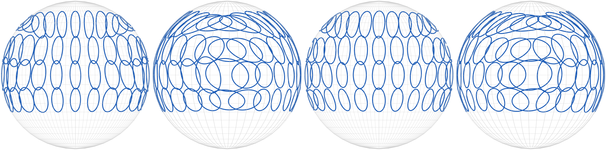

# Evaluating Spatial Discriminability Preservation in HRTF Upsampling Using Fisher Information

Code, results and manuscript for the paper *Evaluating Spatial Discriminability Preservation in
HRTF Upsampling Using Fisher Information*.



Signal-domain errors describe how a reconstructed HRTF differs from the measured one, and
localisation models predict where a listener would point, but neither shows whether a listener can
still tell neighbouring source directions apart. This project measures that directly: the Fisher
information of the auditory cues defines a local discrimination ellipse at every direction, and
reference and reconstructed HRTFs are compared by the size, shape and orientation of those ellipses
(affine-invariant Riemannian metric, AIRM).

The compiled paper is [`paper/Fisher_Rao_HRTF_Evaluation.pdf`](paper/Fisher_Rao_HRTF_Evaluation.pdf).

## Repository layout

```
paper/                       manuscript (.tex, .pdf), its figures/ and tables/, build script
run_evaluation.m             entry point for the reported 41-subject evaluation (MATLAB)
matlab/                      evaluation engine: signal metrics, Fisher tensors, Bayesian observer
  fisher_rao_config.m          every setting of the reported evaluation
  run_fisher_rao_evaluation.m  run loop (resumable, one row at a time)
  private/                     the engine's functions; map in matlab/README.md
  compatibility/               two shims for current MATLAB (matlab/compatibility/README.md)
  postprocessing/              merge of parallel workers; Barumerli response covariances
scripts/                     Python analysis, tables and figures
  fisher_lib.py                reads the tensor files; tensors, AIRM, thresholds from Gram matrices
  cue_fields/                  cue-field roughness and sparse-fit aliasing analyses
  pge_calibration/             the sigma_mon = 2.85 dB calibration
results/
  evaluation/                reported results: one row per subject x method x retention level,
                             plus analysis/ summaries (correlations, paired comparisons, thresholds,
                             template-matched sensitivity, cue-field roughness)
  audits/                    Barumerli response covariances used for the ellipse figure
  pge_calibration/           per-participant sigma_spectral fits
ml_comparator_research/      how the RANF and FSP-AE fields were produced: the shared protocol
                             (comparator_protocol/outputs/hu_hrtfformer_protocol.json: seed-0
                             162/41 subject split and the four sparse masks), the SONICOM adapters,
                             and the staging of their complete model-generated fields
EXTERNAL_DEPENDENCIES.md     datasets, toolboxes and model outputs needed for the full evaluation
requirements.txt             Python packages for scripts/
```

## Evaluation settings (reported results)

- SONICOM `P####_FreeFieldCompMinPhase_48kHz.sofa` files (measured HRIRs with interaural delays),
  41 held-out subjects, retention levels N = 100, 19, 5 and 3 directions.
- Methods: SUpDEq-SH, SUpDEq-MCA, SUpDEq-Natural-MCA, SUpDEq-Bary-MCA, RANF and FSP-AE. RANF and
  FSP-AE are evaluated on their complete model-generated fields, without retained-node replacement.
- Common 16 kHz cue band: every field, reference and reconstructed, is low-passed with the same
  linear-phase FIR before feature extraction, and the gammatone filterbank stops at 16 kHz. This
  applies to the Fisher cues and to the Bayesian observer. LSD is reported over 20 Hz to 16 kHz for
  every method (FSP-AE has no output above 16 kHz).
- Fisher tensor: positive spectral-gradient (PGE), ILD and transformed-ITD cues, spherical-harmonic
  order 6, sigma_mon = 1.25 dB (2.85 dB as a sensitivity analysis; that value is a
  maximum-likelihood calibration on SONICOM localisation data, documented in
  [`scripts/pge_calibration/`](scripts/pge_calibration/README.md)).
- Bayesian observer (AMT `barumerli2023`): band-level spectral features, MAP estimation,
  sigma_spectral = 4 dB, AMT 1.6 defaults otherwise, 300 repetitions per direction.
- Reconstructions whose interpolation stage is undefined (barycentric where the retained directions
  do not surround the listener; natural-neighbour at N = 5 and 3), or that contain non-finite or
  all-zero HRIRs, are reported as not applicable rather than scored.

## Reproducing the results

### 1. Evaluation (MATLAB)

Requires MATLAB (Signal Processing and Statistics toolboxes), AMT 1.6 with the SOFA Toolbox, SUpDEq
and its bundled third-party code, the SONICOM SOFA files under `dependencies/`, and the RANF and
FSP-AE reconstructions under `ml_sofas_without_node_replacement/<METHOD>/N###/Sonicom_<id>.sofa`.
None of these are distributed here; see [`EXTERNAL_DEPENDENCIES.md`](EXTERNAL_DEPENDENCIES.md).

```matlab
run_evaluation("smoke")                                         % one subject, quick check
run_evaluation("fisher")                                        % all rows, no observer
run_evaluation("full", [10 37 73 89 141 168 191], "evaluation_w1")   % one worker
```

Every setting is in `matlab/fisher_rao_config.m`; the phases above only choose the output folder,
the subjects and whether the observer runs. A run evaluates one row at a time and checkpoints after
each, so an interrupted run resumes where it stopped.

The observer is slow, so the reported results were produced by splitting the 41 subjects across
parallel `"full"` workers, one MATLAB process each, and merging them:

```matlab
addpath matlab/postprocessing
merge_worker_runs           % results/evaluation_w* -> results/evaluation
```

Workers are merged in order, and a later worker replaces every row of any subject it contains, so a
subject interrupted in one worker can simply be rerun in a new one. The merge checks that every
protocol row is present exactly once and that every observer row used 300 repetitions. The
Barumerli response covariances for the ellipse figure come from
`matlab/postprocessing/compute_barumerli_response_covariance.m`.

On Windows, do not select text in a worker's console window: QuickEdit mode pauses the process
until the selection is cleared.

### 2. Analysis, tables and figures (Python)

```bash
python -m pip install -r requirements.txt
python scripts/analyse_results.py results/evaluation
python scripts/signed_scale.py
python scripts/write_tables.py              # -> paper/tables/
python scripts/plot_summary_figures.py      # -> paper/figures/ (AIRM, observer, metric figures)
python scripts/plot_ellipse_figures.py      # -> paper/figures/ellipse_comparison.png
```

The sampling-scheme figure (`paper/figures/sampling_scheme_overview.pdf`), a drawing of the four
protocol masks, is included as a static file and is not regenerated by these scripts.

`analyse_results.py` and `signed_scale.py` read the per-subject tensor files in
`results/evaluation/metric_tensors/`, which are produced by step 1 and are too large to keep in
git; they can also be downloaded from Zenodo (see [Local data](#local-data-not-in-git)). The analysis first checks that recomputing the AIRM from the stored per-cue-family Gram
matrices reproduces the MATLAB values, then recomputes the tensors for SH orders 4 and 8 and for
sigma_mon = 2.85 dB without re-extracting cues. Its outputs are committed in
`results/evaluation/analysis/`, so the table and figure scripts run without the tensor files.

### 3. Cue-field roughness and sparse-fit aliasing (Python)

These analyses support the scale caveat in the threshold section and the aliasing explanation in the
discussion. They work on the cue fields of the measured HRTFs directly, with a Python port of the
MATLAB cue pipeline (`scripts/cue_fields/cue_pipeline.py`, which reproduces the MATLAB Fisher tensors
to a maximum pointwise AIRM of 4e-7), and need the SONICOM SOFA files but no evaluation outputs.

```bash
cd scripts/cue_fields
python extract_reference_cues.py   # cue fields of the 41 test subjects (cached, not tracked)
python cue_roughness.py            # -> results/evaluation/analysis/cue_fields/roughness_*.csv
python sparse_fit_aliasing.py      # -> results/evaluation/analysis/cue_fields/sparse_fit_energy.csv
```

Thresholds of the dense reference at SH orders 4, 6 and 8 are written by
`analyse_results.py` to `results/evaluation/analysis/thresholds_by_order.csv`.

### 4. Template-matched sensitivity

The discussion conjectures that spurious Fisher-information gains act as losses for a listener who
decodes with templates from their own ears. `run_evaluation("tensors", ids, name)` reruns
the signal metrics and Fisher tensors without the observer, and also saves the cross terms
J_target' J_recon needed for that observer; split the subjects across parallel processes as for the
full run. Then:

```bash
python scripts/template_matched_sensitivity.py      # reads results/evaluation_tensors*
```

With the Zenodo tensor files, which include the cross terms, run
`python scripts/template_matched_sensitivity.py results/evaluation` instead.

Outputs: `results/evaluation/analysis/template_matched_rows.csv` (per subject x method x
retention level) and `template_matched_summary.csv` (medians over subjects), each for all cues and
separately for spectral and interaural cues. The tensor files themselves are not tracked.

### 5. Boundary check

The SONICOM grid has no directions below -45 deg elevation, so the order-6 SH fit is unconstrained
there. Two scripts check whether this edge distorts the results:

```bash
python scripts/boundary_sensitivity.py results/evaluation   # needs the tensor files
cd scripts/cue_fields && python boundary_raw_vs_sh.py        # needs reference_cues.npz (step 3)
```

The first recomputes every mean AIRM over all directions, without the -45 deg ring and without the
-45 and -30 deg rings (`analysis/boundary_sensitivity_*.csv`). The second compares the reference
tensors ring by ring with finite differences of the measured cues
(`analysis/cue_fields/boundary_raw_vs_sh.csv`). The elevation component of the reference tensor on
the -45 deg ring is inflated by the fit: it is 3.5 times that on the -30 deg ring, whereas the
measured cues change less between -45 and -30 deg than between -30 and -20 deg (ratio 0.6). The
azimuth component agrees with the measured cues (ratios 1.27 and 1.20).
Excluding the ring changes cohort mean AIRM by at most 9% (14% without both rings) and leaves every
method ranking and every sign of the scale error unchanged.

### 6. Paper

```powershell
paper/build_paper.ps1          # or: cd paper; latexmk -pdf Fisher_Rao_HRTF_Evaluation.tex
```

## Local data (not in git)

The evaluation reads and writes large files that git ignores. In a working copy they sit inside the
project folder:

```
dependencies/                        toolboxes and SONICOM SOFA files (EXTERNAL_DEPENDENCIES.md)
ml_sofas_without_node_replacement/   RANF and FSP-AE test fields, <METHOD>/N###/Sonicom_<id>.sofa
results/evaluation/metric_tensors/   tensor files behind results/evaluation/full_evaluation_summary.csv,
                                     one folder per subject, copied from the worker named in its
                                     sourceWorker column
results/evaluation_w1 ... w15/       the parallel "full" runs (signal, Fisher, observer) merged into
                                     results/evaluation; where a subject was re-run, only the later
                                     worker's copy is used
results/evaluation_tensors_w1 ... w4/  "tensors" runs: the same tensors plus the cross terms read by
                                     scripts/template_matched_sensitivity.py
results/evaluation_sequential/       "fisher" run of all 984 rows without the observer; its signal
                                     and Fisher values are identical to the reported ones
results/evaluation_smoke/            smoke run (subject 10, 20 observer repetitions), made before the
                                     closed-hull check for SUpDEq-Bary was added
results/evaluation/analysis/cue_fields/reference_cues.npz   cached cue fields (step 3)
```

The tensor files are archived on Zenodo, [10.5281/zenodo.23439154](https://doi.org/10.5281/zenodo.23439154): the files of the
`tensors` runs, which include the cross terms and are otherwise numerically identical to the files
behind the summary CSV. Unzip `metric_tensors.zip` into `results/evaluation/` so that the subject
folders sit in `results/evaluation/metric_tensors/`; steps 2 and 4 and the first script of step 5
then run without MATLAB.
`SHA256SUMS.txt` in the record lists a checksum for every file.

## Licence

The code and results are released under the MIT licence ([`LICENSE`](LICENSE)). Two files carry
their own licences: `matlab/compatibility/sfs_findvoronoi/findvoronoi.m` (SFS Toolbox, MIT, original
notice retained) and `scripts/pge_calibration/bayesian_listener_pge.patch` (a patch to the
`bayesian_listener` package, EUPL-1.2). The manuscript in `paper/` is not covered by the MIT
licence.

## Data access

SONICOM HRTFs, the toolboxes and the comparator model repositories should be obtained from their
original sources. The Fisher information tensors are on Zenodo, [10.5281/zenodo.23439154](https://doi.org/10.5281/zenodo.23439154) (CC BY 4.0). Questions about the evaluation protocol can be directed to the author.
